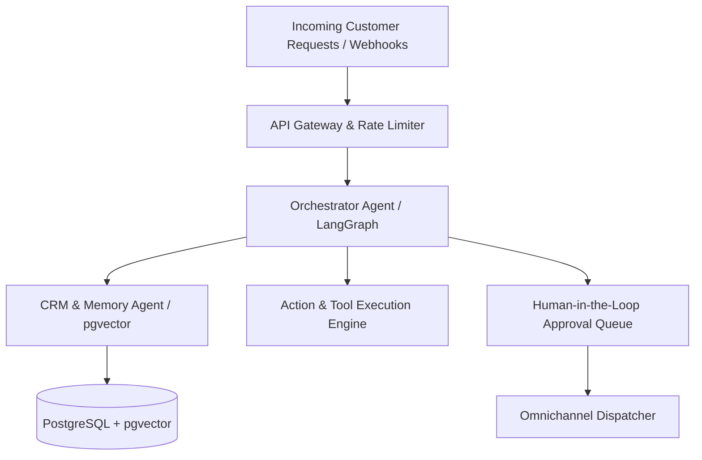

# TEEMETO Core — Intelligent Multi-Agent Workflow Engine for SMEs

[](https://python.org)
[](#architecture)
[](#orchestration)
[](#data-layer)
[](LICENSE)

**TEEMETO** is a next-generation, multi-tenant AI automation platform designed to empower small and medium-sized enterprises (SMEs) and modern creator businesses. By combining deterministic workflow orchestration with specialized Large Language Model (LLM) agents, TEEMETO bridges the gap between chaotic customer touchpoints and structured business execution.

---

## 🌟 Key Features

- **Dynamic Agent Orchestration (LangGraph):** State-machine driven supervisor workflows coordinating specialized task agents with deterministic guardrails.
- **Contextual Memory & CRM (PostgreSQL + pgvector):** Persistent tenant-isolated semantic recall and interaction history ensuring zero data bleed across accounts.
- **Omnichannel Inbox & DM Intelligence:** Automated ingestion, sentiment analysis, task extraction, and RAG-augmented response generation with Human-in-the-Loop (HITL) approval gates.
- **Idempotent Execution Pipeline:** Built-in message deduplication, durable queuing, and transactional audit trails designed for mission-critical business automation.

---

## 🏗 System Architecture



### Core Components

1. **Supervisor Orchestrator:** Manages the task state machine, decomposes incoming requests into atomic specifications, and routes them to sub-agents.
2. **Context Memory Store:** Leverages hybrid vector search (Dense embeddings + metadata filters) on PostgreSQL using `pgvector` with strict Row-Level Security (RLS).
3. **Execution Guardrails:** Ensures every LLM action adheres to tenant-defined rate limits, budget ceilings, and verification criteria.

---

## 🚀 Getting Started

### Prerequisites
- Python 3.11+
- PostgreSQL 15+ with `pgvector` extension enabled
- Docker & Docker Compose (optional for local deployment)

### Installation

```bash
# Clone the repository
git clone https://github.com/teemetoapp/teemeto.git
cd teemeto

# Set up virtual environment
python -m venv .venv
source .venv/bin/activate  # On Windows: .venv\Scripts\activate

# Install dependencies
pip install -e .
```

### Configuration

Copy the example environment configuration:
```bash
cp .env.example .env
```
Configure your database connection strings, vector dimension parameters, and model provider API keys.

---

## 🛡 Security & Compliance

- **Tenant Isolation:** Multi-tenancy enforced at both application middleware and database RLS layers.
- **Audit Trails:** Comprehensive logging of agent decisions, tool invocations, and user confirmations.
- **Safe Approvals:** Direct automated execution is restricted; high-impact actions mandate explicit human authorization (`FULL_APPROVAL` flow).

---

## 👨‍💻 Author & Contact

Developed and maintained by **Alireza Hosseini** & the TEEMETO team.
- **LinkedIn:** [Alireza Hosseini](https://www.linkedin.com/in/alireza-hosseini-43012624b)
- **Organization:** [TEEMETO](https://github.com/teemetoapp)
- **Inquiries:** `teemeto.app@gmail.com`
